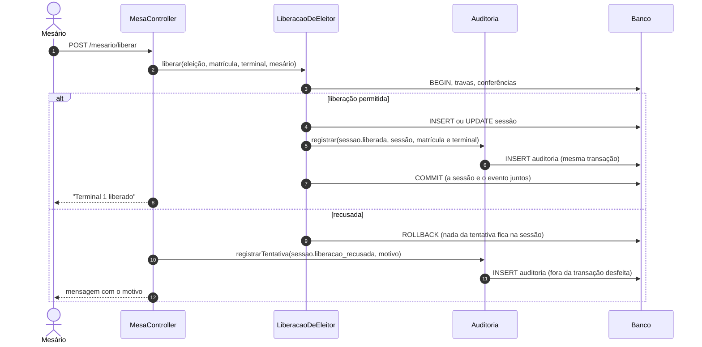

# Plano de auditoria (H11)

Este é o plano do registro de auditoria: **quem fez o quê, quando e de onde**, para a comissão eleitoral prestar contas do processo. Decisão em `DECISOES.md` (D22). A história é a H11, em `HISTORIAS_USUARIO.md`.

> **Situação:**
> - **Fase 1 implementada:** acesso, terminais, sessões e chapas pelo formulário e pela homologação. Código em `App\Support\Auditoria`, `App\Enums\AcaoAuditoria`, `App\Models\EventoAuditoria` e `App\Listeners\AuditarAcesso`; testes em `AuditoriaTest`.
> - **A H8** emite `sessao.votou`, só com o terminal: nunca a chapa (D24).
> - **Fases 2, 3 e 4** seguem planejadas.
> - **Antes da fase 1** não havia auditoria: o que aconteceu até ali não foi registrado, salvo a última decisão de cada chapa (D20).

## 1. Princípios

1. **Nunca em quem alguém votou.** Nenhum evento liga um eleitor ou uma sessão a uma chapa (D3). O voto em si **não gera evento**: só a sessão registra que "votou". Se houvesse um evento por voto, a ordem dos eventos permitiria casar "sessão X votou às 10:42" com "voto na chapa 2 às 10:42".
2. **Só acrescenta (append-only).** Nenhum evento é alterado ou apagado pela aplicação. O model recusa `update` e `delete`; em produção, o usuário do banco também pode ficar sem esses privilégios (fase 4).
3. **A ação e o registro dela vão juntos.** O evento é gravado **na mesma transação** da ação: se a ação for desfeita (rollback), o evento some com ela, e não existe evento de algo que não aconteceu. A exceção são as **tentativas recusadas** (login com senha errada, liberação recusada): elas são gravadas fora da transação desfeita, porque a tentativa aconteceu.
4. **Eventos com nome e intenção.** Cada ação de negócio chama a auditoria explicitamente (`chapa.homologada`, e não "chapa alterada"). Observers automáticos de model perderiam a intenção, seriam disparados pelo seed e pelos testes, e registrariam campos irrelevantes.
5. **Dado pessoal mínimo.** O evento guarda o id e a matrícula do aluno, não o cadastro inteiro: o nome é lido na hora de exibir. Senha, token de pareamento e conteúdo de arquivo nunca entram, apenas o hash SHA-256 de um arquivo importado.
6. **Catálogo fechado.** As ações são casos de um enum (`App\Enums\AcaoAuditoria`). Ação nova exige um caso novo, um teste e uma linha neste documento.

## 2. Tabela `auditoria`

| Coluna          | Tipo               | Para quê                                                                                         |
| --------------- | ------------------ | ------------------------------------------------------------------------------------------------ |
| `id`            | uuid (v7, ordenado) | Padrão do projeto (D11). A ordem de inserção acompanha o tempo                                   |
| `ocorrido_em`   | timestamp(6)       | Quando aconteceu, em microssegundos, para ordenar eventos do mesmo segundo (o model grava com `$dateFormat = 'Y-m-d H:i:s.u'`: sem isso o Laravel descarta a fração) |
| `acao`          | string(50)         | Caso de `AcaoAuditoria` (ex.: `sessao.liberada`)                                                 |
| `user_id`       | bigint, nullable   | Quem fez (FK `users`, `nullOnDelete`). Nulo para o visitante (inscrição pública) e o sistema    |
| `ator`          | string(255)        | Nome e perfil de quem fez, no momento (ex.: "Carlos Mendes (mesário)", "Ana Lima (admin)"; "Visitante" sem login), para o registro sobreviver à edição ou exclusão do usuário |
| `ip`            | string(45)         | IPv4 ou IPv6 (`request()->ip()`, atrás do proxy da Hostinger: `TrustProxies`)                    |
| `eleicao_id`    | uuid, nullable     | Eleição a que o evento se refere (FK, `nullOnDelete`), para filtrar                             |
| `alvo_tipo`     | string(50), nullable | `chapa`, `sessao`, `terminal`, `eleitor`, `cargo`, `eleicao`, `usuario`                       |
| `alvo_id`       | string(36), nullable | Id do alvo (uuid ou bigint como texto). Sem FK: o alvo pode ser excluído e o evento continua   |
| `dados`         | json               | Detalhes da ação: antes e depois, motivo, contagens, hash do arquivo (catálogo abaixo)          |
| `hash`          | char(64), nullable | Fase 4: corrente de hashes (seção 7)                                                             |

Sem `updated_at` (não há edição) e sem `created_at`, porque `ocorrido_em` já faz esse papel.

**Índices:** `(ocorrido_em)`, `(acao, ocorrido_em)`, `(eleicao_id, ocorrido_em)`, `(alvo_tipo, alvo_id)` e `(user_id)`.

**Volume esperado:** algumas centenas de eventos por eleição (cerca de 500 eleitores, uma liberação cada, mais o cadastro). Não precisa de particionamento nem de expurgo automático.

## 3. Catálogo de eventos

Fases explicadas na seção 6. "Ator" é quem aparece em `user_id` e `ator`.

### Acesso (fase 1)

| Ação                 | Quando                                        | Ator           | `dados`                                  |
| -------------------- | --------------------------------------------- | -------------- | ---------------------------------------- |
| `acesso.login`       | Login com sucesso                             | o usuário      | —                                        |
| `acesso.login_falhou`| Senha errada, usuário inexistente ou desativado | visitante    | `email` digitado (em minúsculas), `motivo` |
| `acesso.bloqueado`   | Muitas tentativas (`Lockout`, H1)             | visitante      | `email`, `segundos`                      |
| `acesso.logout`      | Saiu                                          | o usuário      | —                                        |

### Mesa e terminais (fase 1)

| Ação                       | Quando                                                     | Alvo     | `dados`                                              |
| -------------------------- | ---------------------------------------------------------- | -------- | ---------------------------------------------------- |
| `terminal.ativado`         | Computador pareado em `/terminal/ativar` (D16)              | terminal | `numero`, `substituiu_outro_computador` (bool)       |
| `terminal.desativado`      | Admin desativou o pareamento                               | terminal | `numero`                                             |
| `sessao.liberada`          | Primeira liberação do eleitor nesta eleição (H6)           | sessão   | `matricula`, `terminal`, `expira_em`                 |
| `sessao.reliberada`        | Nova liberação depois de expirar ou cancelar (H6, D21)     | sessão   | `matricula`, `terminal`, `terminal_anterior`, `situacao_anterior` (`expirada`/`cancelada`) |
| `sessao.cancelada`         | Mesário cancelou (H6)                                      | sessão   | `matricula`, `terminal`                              |
| `sessao.liberacao_recusada`| Tentativa barrada: já votou, terminal ocupado, o próprio voto... | —  | `matricula`, `terminal`, `motivo` (o texto mostrado ao mesário) |
| `sessao.votou`             | O eleitor confirmou o voto na urna (H8)                    | sessão   | `terminal`. **Nunca a chapa.**                       |

"Expirou" não é evento: a expiração é calculada (D21). Ela aparece como `situacao_anterior: expirada` na re-liberação.

### Chapas (fase 1)

| Ação                       | Quando                                           | Alvo  | `dados`                                                    |
| -------------------------- | ------------------------------------------------ | ----- | ---------------------------------------------------------- |
| `chapa.inscrita`           | Inscrição pelo formulário público (H14)          | chapa | `numero`, `nome`, `matriculas` (cargo → matrícula). Ator: visitante, **com IP** |
| `chapa.homologada`         | H3                                               | chapa | `numero`                                                   |
| `chapa.indeferida`         | H3                                               | chapa | `numero`, `motivo`                                         |
| `chapa.reaberta`           | H3: voltou para pendente                          | chapa | `numero`, `situacao_anterior`                              |
| `chapa.candidato_trocado`  | H3: correção da composição                        | chapa | `cargo`, `matricula_anterior`, `matricula_nova`, `voltou_para_pendente` |
| `chapa.excluida`           | H3                                               | chapa | `numero`, `nome`, `matriculas`                             |

### Cadastros e importações (fase 2)

| Ação                                   | Quando                     | `dados`                                                          |
| -------------------------------------- | -------------------------- | ---------------------------------------------------------------- |
| `eleicao.criada` / `.alterada` / `.excluida` | H2                 | campos alterados, antes → depois (datas em ISO 8601)             |
| `eleicao.ativada` / `.desativada`      | H2                         | `titulo`                                                         |
| `cargo.criado` / `.renomeado` / `.movido` / `.removido` / `.copiados` | H13 | `titulo`, `ordem`; na cópia, `de_eleicao` e `quantidade` |
| `eleitor.criado` / `.alterado` / `.excluido` | H4                   | `matricula`, campos alterados (antes → depois)                   |
| `eleitores.importados`                 | H4, confirmação (D19)      | `arquivo` (nome), `sha256`, `criados`, `atualizados`, `iguais`, `ignoradas` |
| `chapas.importadas`                    | H15, confirmação (D19)     | `arquivo`, `sha256`, `numeros` importados, `ignoradas`, `cargos_criados` |
| `importacao.cancelada`                 | H4/H15, rollback na conferência | `tipo`, `arquivo`, `sha256`                                 |
| `terminal.criado` / `.alterado` / `.excluido` | H5                  | `numero`, `local`                                                |
| `usuario.criado` / `.alterado` / `.desativado` / `.reativado` / `.excluido` | H1 | `email`, `perfil`, campos alterados. **Sem senha** (só `senha_trocada: true`) |

### Resultado (H10, implementado)

| Ação                   | Quando                         | `dados`                   |
| ---------------------- | ------------------------------ | ------------------------- |
| `resultado.consultado` | Admin abriu a apuração         | —                         |
| `ata.exportada`        | Admin baixou a ata             | `formato`, `sha256` do arquivo |
| `auditoria.exportada`  | Admin exportou a auditoria (fase 3) | filtros usados, `sha256` do CSV |

## 4. Como o código registra

```php
// App\Support\Auditoria: o único ponto de escrita.
Auditoria::registrar(AcaoAuditoria::ChapaHomologada, alvo: $chapa, dados: ['numero' => $chapa->numero]);
```

- **`registrar()`** lê o usuário (`auth()->user()`) e o IP (`request()->ip()`) do contexto, monta `ator` e grava. A eleição vem do alvo (`$alvo->eleicao_id`), ou de um parâmetro quando o alvo não tem eleição.
- **Dentro da transação da ação.** As classes de regra (`InscricaoDeChapa`, `HomologacaoDeChapa`, `LiberacaoDeEleitor`, `CargosDaEleicao`, os importadores) chamam `registrar()` antes do `COMMIT`. Fora de uma transação, o evento é gravado na hora.
- **Tentativas recusadas** (`registrarTentativa()`): o controller grava depois que a exceção desfez a transação. Exemplo: `MesaController::liberar` pega a `LiberacaoRecusada`, registra `sessao.liberacao_recusada` e volta para a tela.
- **Login e logout** vêm dos eventos do Laravel (`Login`, `Failed`, `Logout`, `Lockout`), ouvidos pelo `App\Listeners\AuditarAcesso`, registrado no `AppServiceProvider`. O motivo da falha é `usuario_inexistente`, `usuario_desativado` ou `senha_incorreta`.
- **Ativação de terminal** é registrada **antes** do logout que ela provoca (D16), para o evento ter quem ativou.
- **O model `EventoAuditoria`** lança exceção em `updating` e `deleting`. Não tem `$fillable` para `hash` (fase 4).
- **Sigilo, de novo:** `Auditoria::registrar` recusa (`InvalidArgumentException`) `dados` com as chaves `chapa_id` ou `voto` quando a ação é da categoria `sessao`. O teste confere isso para todas as ações.



## 5. Tela `/admin/auditoria`

- **Só admin.** O mesário não vê, porque a auditoria inclui o trabalho dele.
- **Filtros:** eleição (a ativa por padrão), categoria (acesso, mesa, chapas, cadastros, importações), ação, usuário, período (de/até) e busca por matrícula ou número de chapa (`dados`).
- **Lista:** mais recentes primeiro, 50 por página. Cada linha mostra a hora (com segundos), a ação em português (`AcaoAuditoria::rotulo()`), o ator, o IP, o alvo (com link para a chapa, o terminal...) e um resumo dos `dados`. "Ver detalhes" abre o JSON formatado.
- **Exportar CSV** do filtro atual, para anexar à ata. A exportação também vira evento (`auditoria.exportada`).
- **Atalhos:** na lista de chapas (H3), "Histórico" abre a auditoria filtrada pela chapa. No painel do mesário, o admin vê as últimas recusas.

## 6. Fases

A ordem segue o risco. Quanto antes um evento for registrado, menos histórico se perde: o que já aconteceu sem auditoria não é recuperado.

| Fase | Entrega | Quando |
| ---- | ------- | ------ |
| **1. Núcleo** | Tabela, model só-acrescenta, `Auditoria::registrar` e `registrarTentativa`, enum `AcaoAuditoria`, listener de acesso. Eventos de **acesso, terminais, sessões e chapas** (seção 3). Testes de sigilo e de rollback | **Antes da H8 (votar)**: o voto precisa nascer emitindo `sessao.votou`. A H7 (urna) não gera eventos e pode vir antes |
| **2. Cadastros e importações** | Eventos de eleição, cargo, eleitor, terminal, usuário e das importações (com o SHA-256 do arquivo) | Logo depois da fase 1 |
| **3. Tela** | `/admin/auditoria` com filtros, detalhes, exportação CSV e o atalho "Histórico" nas chapas; menu habilitado | Sprint 4, com a H10 |
| **4. Integridade (opcional)** | Corrente de hashes e comando `php artisan digitech:auditoria:verificar`; em produção, usuário do banco sem `UPDATE`/`DELETE` na tabela | Antes da eleição real (H12) |

## 7. Integridade (fase 4, opcional)

Cada evento guarda `hash = SHA-256(hash do evento anterior + conteúdo canônico deste)`. Alterar ou apagar uma linha no banco, por fora da aplicação, quebra a corrente a partir dela. O comando de verificação recalcula tudo e aponta o primeiro evento adulterado.

- **Ordem:** gravar o próximo hash exige ler o último, e duas gravações ao mesmo tempo podem ler o mesmo. A gravação trava uma linha "cabeça" (`SELECT ... FOR UPDATE`) e atualiza o último hash nela. Com centenas de eventos por eleição, a espera é desprezível.
- **Âncora:** no fim da votação, o hash do último evento vai impresso na ata (H10). Assim, mesmo quem tem acesso ao banco não reescreve a corrente inteira sem que a ata denuncie.
- **Limite:** a corrente detecta adulteração, não a impede. A proteção de verdade é o acesso restrito ao banco em produção.

## 8. Retenção e privacidade

- Os eventos ficam enquanto a eleição existir, e a eleição com votos não pode ser apagada (D3). Depois do prazo de recurso definido pela comissão, a auditoria é exportada (CSV com o hash final) e arquivada junto com a ata.
- **O que fica:** matrícula, IP e e-mail digitado no login, dados necessários para a prestação de contas. **O que não fica:** senha, token, conteúdo de arquivo, chapa escolhida.
- `laravel.log` não substitui a auditoria e não deve receber dados de voto. O `POST /urna/votar` (H8) não registra o corpo da requisição em nenhum log.

## 9. Testes (por fase)

- **Cada ação do catálogo** gera exatamente um evento com o ator, o IP, o alvo e os `dados` esperados (um teste por grupo, como `AuditoriaChapasTest`).
- **Rollback:** uma ação recusada no meio da transação (ex.: período fechou) não deixa o evento da ação, só o de tentativa, quando houver.
- **Só acrescenta:** `update` e `delete` no model lançam exceção.
- **Sigilo:**
  - depois de uma votação simulada (H8), nenhum evento tem `chapa_id`;
  - o número de eventos `sessao.votou` é igual ao de sessões `votou`;
  - nenhum evento é gravado na criação do voto.
- **Tela:** filtros, paginação, exportação e acesso negado ao mesário.
- **Fase 4:** adulterar uma linha faz o comando de verificação falhar apontando aquele evento.

## 10. O que muda no código já pronto

| Onde | O que entra |
| ---- | ----------- |
| `LoginController`, `LoginRequest` | Listener dos eventos de acesso (nenhuma mudança na regra) |
| `TerminalAtivacaoController`, `Admin\TerminalController` | `terminal.ativado` (com `substituiu_outro_computador`) e `terminal.desativado` |
| `LiberacaoDeEleitor`, `MesaController` | `sessao.liberada`, `.reliberada`, `.cancelada` e `.liberacao_recusada` |
| `InscricaoDeChapa` | `chapa.inscrita` (formulário, com IP) |
| `HomologacaoDeChapa` | `chapa.homologada`, `.indeferida`, `.reaberta`, `.candidato_trocado` e `.excluida` |
| `ImportadorChapas`, `ImportadorEleitores`, controllers de importação | Eventos de importação (fase 2) |
| `CargosDaEleicao`, controllers de eleição, eleitor e usuário | Eventos de cadastro (fase 2) |
| `layouts/painel.blade.php` | Menu "Auditoria" habilitado (fase 3) |
