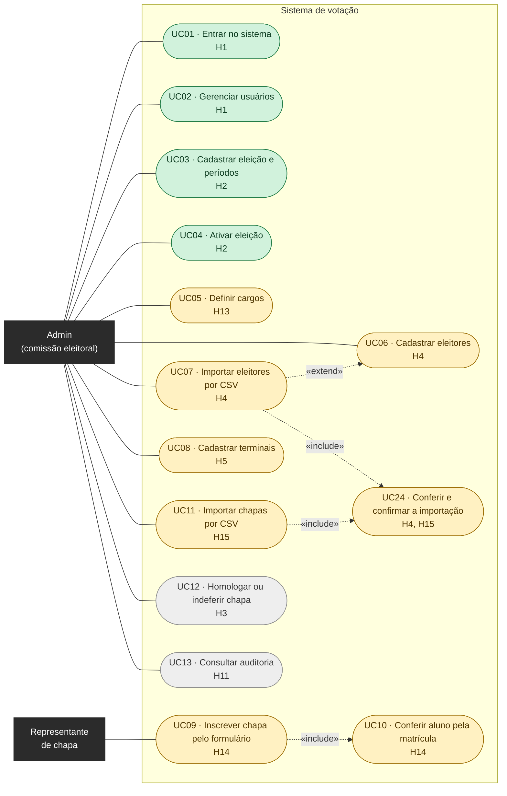
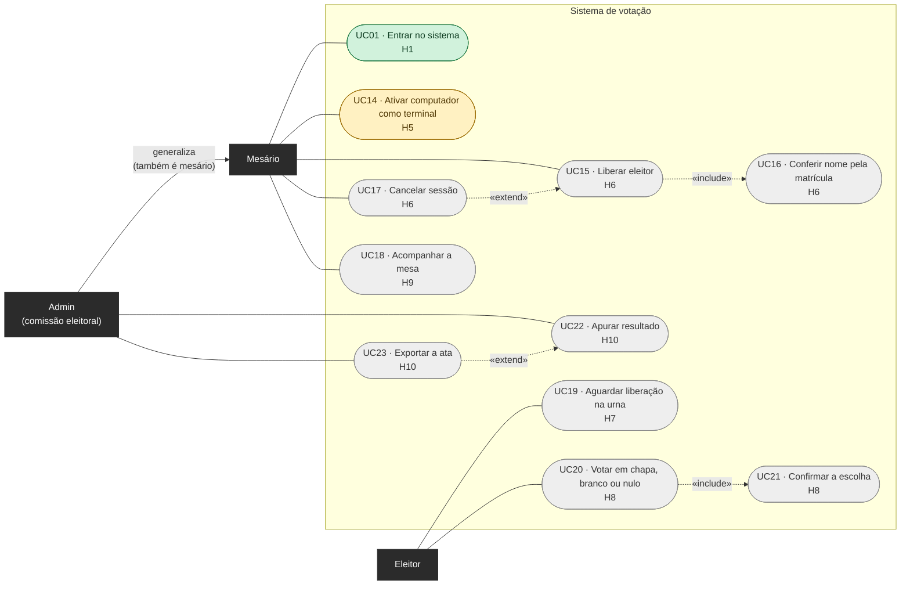
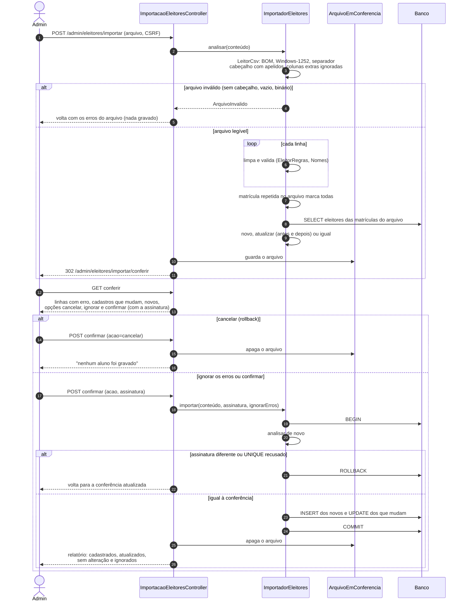
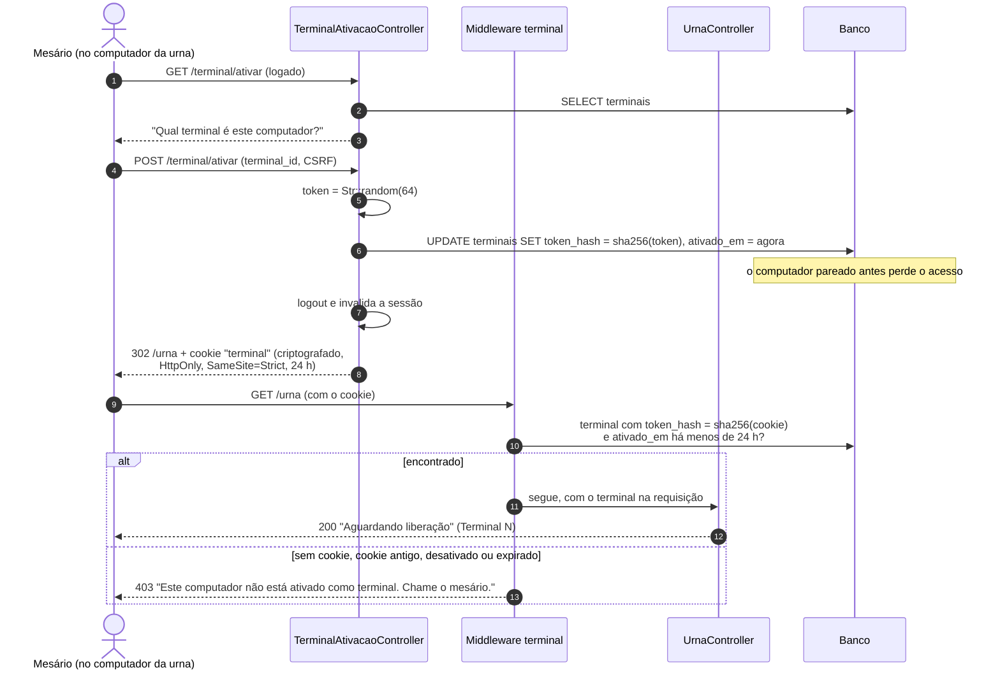
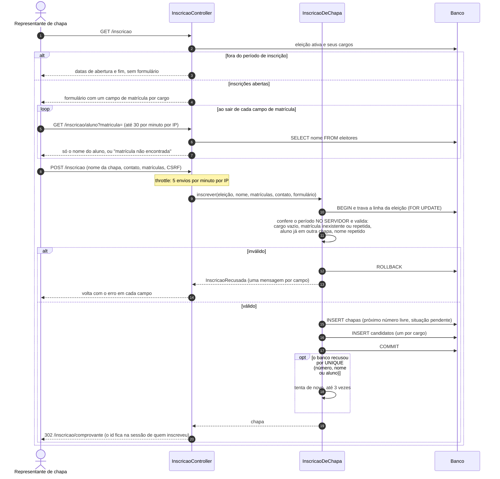
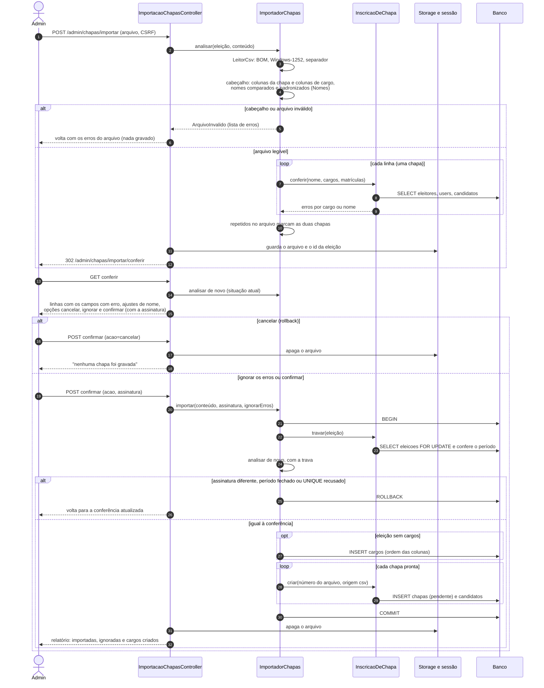
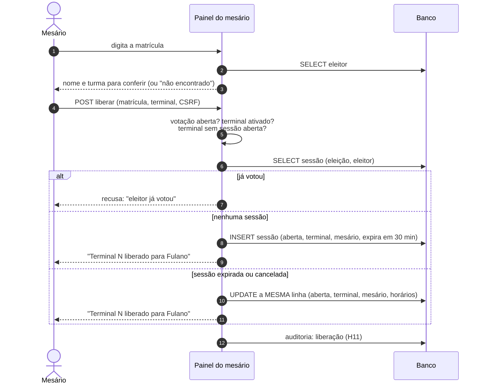
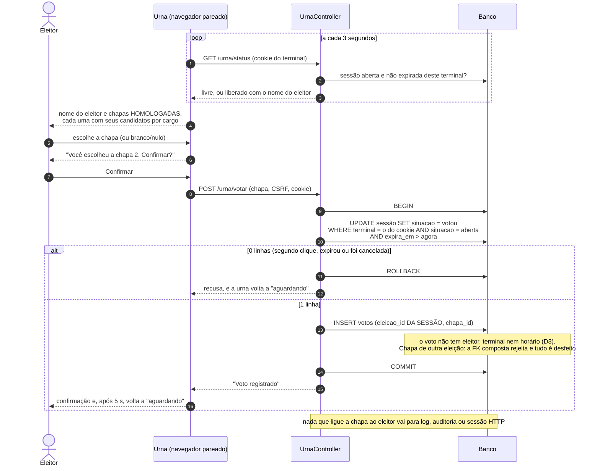

# Diagramas UML

Casos de uso e diagramas de sequência do sistema. O diagrama entidade-relacionamento do banco fica em [`MODELO_DADOS.md`](MODELO_DADOS.md).

Os diagramas são escritos em [Mermaid](https://mermaid.js.org/). O GitHub desenha os blocos ` ```mermaid ` direto nesta página; no VS Code, a extensão *Markdown Preview Mermaid Support* mostra a prévia. Para testar uma alteração, cole o bloco em [mermaid.live](https://mermaid.live).

**Cuidado ao editar:** não use `;` no texto dos diagramas de sequência, porque o Mermaid o lê como fim de comando e o diagrama inteiro deixa de aparecer.

**Mantenha atualizado:** quem implementa uma história ajusta, na mesma PR, o caso de uso dela (cor de situação) e o diagrama de sequência correspondente, se o fluxo mudou. Os diagramas marcados como *planejado* são o contrato da história: se a implementação precisar de outro caminho, mude o diagrama e explique na PR.

## Casos de uso

Situação de cada caso de uso, pela cor:


Para mudar a situação, troque a classe do caso de uso nas linhas `class ... feito` / `revisao` / `afazer` no fim do bloco.

### Configuração e inscrição de chapas

Antes do dia da votação: a comissão (admin) monta a eleição e o eleitorado; o representante de chapa inscreve a chapa pelo formulário público, sem login (D14).



### Dia da votação e resultado

O eleitor não faz login: o mesário o libera para um terminal pareado (D4, D16). O admin também pode fazer tudo o que o mesário faz (generalização: o admin **é um** mesário com mais permissões, D15).



**Como ler:** linha cheia liga o ator ao caso de uso que ele executa. `«include»` é um passo que **sempre** acontece dentro do caso de uso de origem (não dá para liberar sem conferir o nome). `«extend»` é um comportamento **opcional** que estende o caso de uso de destino (importar por CSV é outra forma de cadastrar eleitores; cancelar é opcional depois de liberar).

## Diagramas de sequência

| Diagrama | Histórias | Situação |
| --- | --- | --- |
| [S1 · Importar eleitores por CSV](#s1--importar-eleitores-por-csv-h4) | H4, D19 | Implementado (PR #54; conferência na D19) |
| [S2 · Ativar o computador como terminal](#s2--ativar-o-computador-como-terminal-h5-d16) | H5, D16 | Implementado (PR #55) |
| [S3 · Inscrever chapa pelo formulário](#s3--inscrever-chapa-pelo-formulário-h14) | H14 | Implementado (PR #58) |
| [S6 · Importar chapas por CSV](#s6--importar-chapas-por-csv-h15-d19) | H15, D19 | Implementado (PR #59) |
| [S4 · Liberar um eleitor](#s4--liberar-um-eleitor-h6) | H6 | Planejado |
| [S5 · Urna aguarda e o eleitor vota](#s5--urna-aguarda-e-o-eleitor-vota-h7-h8) | H7, H8 | Planejado |

Nos planejados, nomes de colunas como `situacao` e `expira_em` são sugestões (`MODELO_DADOS.md`): a equipe decide na história.

### S1 · Importar eleitores por CSV (H4)

Mesmo fluxo das chapas (D19, S6): enviar só confere; o admin vê os campos com erro, o que é novo e o que vai mudar, e escolhe cancelar (rollback), ignorar as linhas com erro ou confirmar. Matrícula já cadastrada atualiza, não duplica (D17).



### S2 · Ativar o computador como terminal (H5, D16)

O banco guarda só o hash do token; o navegador é deslogado na mesma resposta, para o eleitor nunca encontrar uma sessão de mesário aberta.



### S3 · Inscrever chapa pelo formulário (H14)

Página pública, sem login. Chapa e candidatos entram juntos ou não entram (D14). As regras ficam em `App\Support\InscricaoDeChapa`, reaproveitadas pelo CSV (H15, D18).



### S6 · Importar chapas por CSV (H15, D19)

Enviar só confere. O admin vê cada campo com erro e escolhe cancelar (rollback), ignorar as chapas com erro ou confirmar. A confirmação grava numa transação só e desfaz tudo se a situação mudou desde a conferência.



### S4 · Liberar um eleitor (H6)

*Planejado.* Uma linha por eleitor e eleição (`UNIQUE`): liberar de novo reaproveita a linha, nunca cria outra.



### S5 · Urna aguarda e o eleitor vota (H7, H8)

*Planejado.* O ponto crítico é a ordem da transação: **reivindicar a sessão antes de gravar o voto**. Assim duplo clique, F5 ou duas abas não geram dois votos (`MODELO_DADOS.md`, "Registro de um voto").


