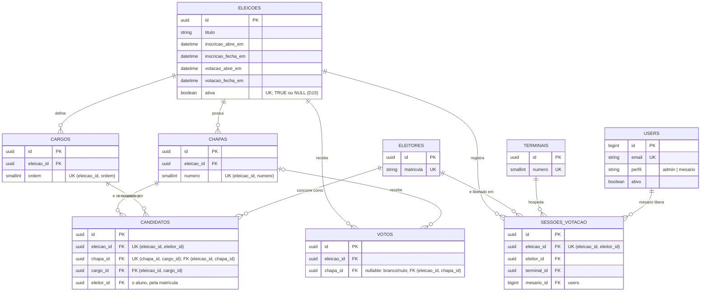

# Modelo de dados

Banco: MySQL/MariaDB, charset `utf8mb4`. Estrutura versionada em `database/migrations/`.

**As migrations do scaffold contêm apenas chaves e constraints.** Os demais atributos de cada tabela (nomes, datas, situação, e-mail, descrição...) são decisão da equipe, adicionados por novas migrations. Nunca altere tabela pelo phpMyAdmin: `php artisan make:migration add_titulo_to_eleicoes_table`.

## Diagrama entidade-relacionamento (o que existe hoje)



Repare: **nenhuma linha liga `VOTOS` a `ELEITORES`, `TERMINAIS`, `USERS` ou `SESSOES_VOTACAO`.** Isso é o sigilo do voto (`DECISOES.md`, D3). O voto também não aponta para `CANDIDATOS`: vota-se na chapa inteira (D13). `users` tem `name`/`password` do Laravel; `created_at`/`updated_at` existem em todas as tabelas (convenção do Eloquent) e foram omitidos do diagrama, **exceto em `votos`, que não tem timestamps**.

**Chaves:** as tabelas do domínio usam **UUID** (`char(36)`); `users` e as tabelas internas do Laravel continuam `bigint` (ver `DECISOES.md`, D11). Em `votos` o UUID é **v4 aleatório**; nas demais, ordenado por tempo (padrão do `HasUuids`).

## Constraints e o que cada uma garante

| Constraint                                        | Regra de negócio garantida pelo banco                                   | Teste            |
| ------------------------------------------------- | ----------------------------------------------------------------------- | ---------------- |
| `votos` sem `created_at`/`updated_at` e com `id` UUID v4 | Sigilo do voto: não dá para cruzar ordem/horário com `sessoes_votacao` | `ConstraintsTest` |
| `sessoes_votacao UNIQUE (eleicao_id, eleitor_id)` | Um eleitor tem **uma** sessão por eleição: sem voto duplo               | `ConstraintsTest` |
| `chapas UNIQUE (eleicao_id, numero)`              | Número de chapa único dentro da eleição; pode repetir em outra eleição  | `ConstraintsTest` |
| `eleicoes.ativa UNIQUE`, com TRUE ou NULL (nunca FALSE) | **Só uma eleição ativa**: o índice único aceita vários NULL e um único TRUE (D15) | `ConstraintsTest` |
| `eleitores.matricula UNIQUE`                      | Um cadastro por matrícula. Todo aluno, eleitor ou candidato, é identificado por ela | —                |
| `cargos UNIQUE (eleicao_id, ordem)`               | Cada eleição tem sua lista de cargos, sem duas posições iguais na cédula | `ConstraintsTest` |
| `candidatos UNIQUE (chapa_id, cargo_id)`          | Um candidato por cargo em cada chapa                                    | `ConstraintsTest` |
| `candidatos UNIQUE (eleicao_id, eleitor_id)`      | O aluno concorre em **uma** chapa e **um** cargo por eleição; pode concorrer de novo em outra | `ConstraintsTest` |
| `candidatos (eleicao_id, chapa_id)` → `chapas` e `(eleicao_id, cargo_id)` → `cargos` | Chapa, cargo e candidatura são da **mesma eleição** | `ConstraintsTest` |
| `candidatos.eleitor_id` FK `ON DELETE RESTRICT`   | Candidato precisa ser aluno cadastrado; aluno que é candidato não pode ser apagado | `ConstraintsTest` |
| `ON DELETE CASCADE` de `chapas`, `cargos` e `eleicoes` para `candidatos` | Apagar uma chapa inscrita errada (sem votos) apaga sua composição; o aluno continua cadastrado | `ConstraintsTest` |
| `terminais.numero UNIQUE`                         | Um terminal por número (o que o mesário vê e escolhe). A urna não tem ID na URL: identifica o terminal pelo cookie de pareamento (D16) | —                |
| `votos` sem FK para eleitor/terminal/sessão       | Sigilo do voto                                                          | `ConstraintsTest` |
| `votos.chapa_id` nullable                         | Voto em branco/nulo possível sem chapa                                  | `ConstraintsTest` |
| `votos (eleicao_id, chapa_id)` → `chapas (eleicao_id, id)` | O voto só vai para uma chapa **da mesma eleição** (sem isso, um voto da eleição A poderia contar para uma chapa da eleição B) | `ConstraintsTest` |
| `votos.eleicao_id` e `votos.chapa_id ON DELETE RESTRICT` | Eleição ou chapa que **já recebeu votos não pode ser apagada**: o resultado é histórico (D5) | `ConstraintsTest` |
| `ON DELETE CASCADE` de `eleicoes` para `chapas` e `sessoes_votacao` | Apagar eleição **sem votos** (ex.: cadastrada errada) apaga chapas e sessões dela | `ConstraintsTest` |
| `sessoes_votacao.terminal_id ON DELETE RESTRICT`  | Terminal com histórico de sessão não pode ser apagado                   | `ConstraintsTest` |
| `sessoes_votacao.eleitor_id ON DELETE RESTRICT`   | Eleitor já liberado não pode ser apagado: a ata não perde quem votou     | `ConstraintsTest` |
| `sessoes_votacao.mesario_id NOT NULL` e `ON DELETE RESTRICT` | Toda liberação tem um mesário responsável; usuário com liberações não é apagado (desativar, H1) | `ConstraintsTest` |

## Atributos: perguntas para a equipe responder (uma migration por resposta)

| Tabela            | O que falta decidir                                                                                   | História |
| ----------------- | ----------------------------------------------------------------------------------------------------- | -------- |
| ~~`users`~~       | **Respondido na H1 (D15):** coluna `perfil` (`admin`/`mesario`, enum `App\Enums\Perfil`) e `ativo` (desativar sem apagar) | H1       |
| ~~`eleicoes`~~    | **Respondido na H2 (D15):** `titulo`, `inscricao_abre_em`, `inscricao_fecha_em`, `votacao_abre_em`, `votacao_fecha_em` e `ativa` (TRUE ou NULL, com UNIQUE). A fase é calculada pelas datas (`App\Enums\FaseEleicao`) | H2       |
| `cargos`          | Título (Presidente, Vice-presidente, 1º Secretário...). A **quantidade de candidatos por chapa** é o número de cargos da eleição | H13      |
| `chapas`          | Nome, descrição, foto; **situação** da inscrição (`pendente` → `homologada` \| `indeferida`), motivo do indeferimento, contato do responsável, origem (formulário ou CSV) | H3, H14, H15 |
| `candidatos`      | Precisa de algo além da ligação aluno-cargo-chapa? (ex.: foto). Nome e matrícula vêm de `eleitores` | H14      |
| ~~`eleitores`~~   | **Respondido na H4 (D17):** `nome`, `turma` (opcional) e `email` (opcional). Cadastro único de alunos, apto em **toda** eleição: sem tabela `eleicao_eleitor`. Candidato precisa estar cadastrado em `eleitores` | H4       |
| ~~`terminais`~~   | **Respondido na H5 (D16):** `local` (opcional), `token_hash` (SHA-256 do token de pareamento, nullable, único) e `ativado_em` (o pareamento vale 24 horas a partir daqui) | H5       |
| `sessoes_votacao` | Situação (aberta/votou/expirada/cancelada), horários de liberação, expiração e voto                   | H6, H8   |
| `votos`           | Como diferenciar branco de nulo (coluna `tipo`?), quando foi registrado (cuidado: horário exato + poucos votantes permite correlacionar com a sessão) | H8, H10 |
| (nova) auditoria  | Quem fez o quê e quando; nunca em quem votou                                                          | H11      |

### Formato do CSV de eleitores (H4)

Uma linha por **aluno**, com cabeçalho. Separador `;` (padrão do Excel em português) ou `,`; UTF-8 com ou sem BOM (arquivo do Excel em Windows-1252 também é aceito). Exemplo em [`docs/exemplos/eleitores.csv`](exemplos/eleitores.csv), que também pode ser baixado na tela de importação.

```csv
matricula;nome;turma;email
2024101;Ana Beatriz Lima;ADS 3;ana.lima@aluno.unicatolica.edu.br
2024102;Bruno Carvalho;ADS 3;
```

| Coluna      | Regra                                                                 |
| ----------- | --------------------------------------------------------------------- |
| `matricula` | Obrigatória; até 20 caracteres: letras, números, ponto e hífen        |
| `nome`      | Obrigatório; até 150 caracteres                                       |
| `turma`     | Opcional; até 50 caracteres                                           |
| `email`     | Opcional; e-mail válido                                               |

O cabeçalho ignora acentos, maiúsculas e hífen (`Matrícula`, `E-mail` valem). Validação **linha a linha**: linha inválida entra no relatório (linha, matrícula e motivo) e as outras são gravadas. Matrícula que já existe **atualiza** o cadastro: o nome sempre, a turma e o e-mail só se vierem preenchidos (coluna vazia não apaga o que já estava). As regras são as mesmas do formulário (`App\Support\EleitorRegras`).

## Inscrição de chapas (H13, H14, H15, H3)

Antes da votação há uma fase de **inscrição**, com período próprio em cada eleição:

```
 admin cria a eleição ─▶ admin define cargos ─▶ inscrições abertas ─▶ inscrições encerradas ─▶ votação
 (H2: datas)             (H13: Presidente,      (H14 formulário,      (composição congela;      (H6–H8: só chapas
                          Vice…)                 H15 CSV: pendente)    H3: homologar)            homologadas)
```

Linha do tempo de uma eleição (validada na aplicação, H2):

`inscricao_abre_em` < `inscricao_fecha_em` ≤ `votacao_abre_em` < `votacao_fecha_em` (`App\Http\Requests\EleicaoRequest`). Cada período inclui o início e exclui o fim.

Regras:

- **Cargos primeiro.** Os cargos são definidos antes de abrir as inscrições e **não mudam depois que a primeira chapa se inscreve**: mudar a lista deixaria chapas já inscritas incompletas.
- **Chapa completa ou nada.** Uma chapa só é gravada com **um candidato para cada cargo** da eleição, na mesma transação (chapa + todos os candidatos). Isso a aplicação garante; o banco garante que não há **dois** candidatos no mesmo cargo nem o mesmo aluno em duas chapas.
- **Candidato é aluno.** Cada candidato é indicado pela **matrícula**, que precisa existir em `eleitores` (por isso o eleitorado, H4, é importado antes de abrir as inscrições).
- **Dentro do período.** Formulário (H14) e CSV (H15) só gravam entre a abertura e o fim das inscrições. Fora dele, o formulário mostra as datas e não aceita envio.
- **Toda inscrição entra `pendente`.** A comissão eleitoral (admin) homologa ou indefere com motivo (H3). Só chapas **homologadas** aparecem na urna e na apuração.
- **Número da chapa.** Atribuído na inscrição (o próximo livre na eleição). Duas inscrições simultâneas podem tentar o mesmo número: o `UNIQUE (eleicao_id, numero)` rejeita uma e a aplicação tenta o próximo.
- **Depois do fim das inscrições, a composição congela**: só muda a situação (homologar/indeferir).

### Formato do CSV de chapas (H15)

Uma linha por **candidato**; as linhas de uma mesma chapa repetem o número e o nome. Separador `;` (padrão do Excel em português), UTF-8, com cabeçalho. Exemplo completo em [`docs/exemplos/chapas.csv`](exemplos/chapas.csv).

```csv
numero_chapa;nome_chapa;cargo;matricula
1;Movimento Estudantil;Presidente;2024101
1;Movimento Estudantil;Vice-presidente;2024102
```

| Coluna         | Regra                                                                        |
| -------------- | ---------------------------------------------------------------------------- |
| `numero_chapa` | Inteiro; agrupa as linhas da mesma chapa; não pode já existir na eleição     |
| `nome_chapa`   | Igual em todas as linhas da chapa                                            |
| `cargo`        | Título de um cargo **desta** eleição (sem diferenciar maiúsculas/minúsculas) |
| `matricula`    | Aluno cadastrado em `eleitores`; não pode estar em outra chapa da eleição    |

Validação **por chapa, tudo ou nada**: se qualquer linha de uma chapa falhar (cargo faltando, cargo repetido, matrícula inexistente, aluno já em outra chapa), **a chapa inteira** é rejeitada e o relatório diz a linha e o motivo. As outras chapas do arquivo entram normalmente, como `pendente`.

## Ciclo de vida da sessão (uma linha por eleitor e eleição)

`UNIQUE (eleicao_id, eleitor_id)` vale para **toda** a vida da sessão, não só para o voto. Por isso:

- **Liberar** cria a linha. **Re-liberar** (sessão expirada ou cancelada) faz `UPDATE` na mesma linha (situação, terminal, mesário, horários), nunca um segundo `INSERT`: o banco rejeitaria.
- Sessão que já **votou** é final: nunca volta a aberta.
- Como a linha guarda só o estado atual, o histórico (liberou no terminal 2, expirou, liberou no 3) fica na auditoria (H11).

Situações sugeridas: `aberta` → `votou` | `expirada` | `cancelada`; `expirada`/`cancelada` → `aberta` (re-liberação).

## Registro de um voto (transação)

"Verificar que a sessão está aberta e depois inserir o voto" tem **condição de corrida**: com duplo clique ou duas abas, as duas requisições passam pela verificação antes de qualquer uma marcar a sessão, e entram **dois votos**. A ordem certa é **reivindicar a sessão primeiro, de forma atômica**:

```php
DB::transaction(function () use ($sessao, $chapaId) {
    // 1. Reivindica a sessão: só UMA requisição consegue mudar 'aberta' para 'votou'.
    $afetadas = SessaoVotacao::whereKey($sessao->id)
        ->where('situacao', 'aberta')            // nomes de colunas: decisão da equipe
        ->where('expira_em', '>', now())
        ->update(['situacao' => 'votou', 'votou_em' => now()]);

    if ($afetadas !== 1) {
        throw new SessaoIndisponivel();          // já votou, expirou ou foi cancelada
    }

    // 2. Grava o voto. eleicao_id vem da SESSÃO, nunca do formulário.
    Voto::create(['eleicao_id' => $sessao->eleicao_id, 'chapa_id' => $chapaId]);
});
```

- Se o passo 2 falhar (ex.: chapa de outra eleição, rejeitada pela FK composta), o passo 1 é desfeito.
- O `UPDATE ... WHERE situacao = 'aberta'` é atômico no MySQL e no SQLite; não depende de `lockForUpdate()`.
- **Sigilo também fora do banco:** não registre a chapa escolhida em log, auditoria, sessão HTTP ou flash junto com o eleitor/sessão. O que vai para a auditoria é "sessão X votou", nunca em quem.
