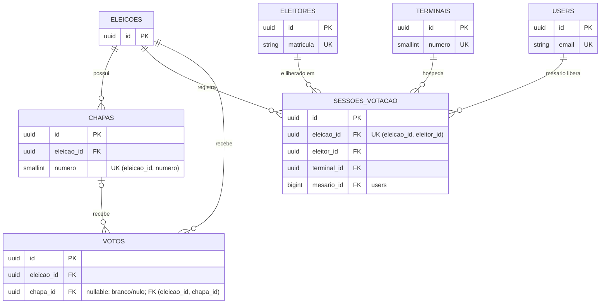

# Modelo de dados

Banco: MySQL/MariaDB, charset `utf8mb4`. Estrutura versionada em `database/migrations/`.

**As migrations do scaffold contêm apenas chaves e constraints.** Os demais atributos de cada tabela (nomes, datas, situação, e-mail, descrição...) são decisão da equipe, adicionados por novas migrations. Nunca altere tabela pelo phpMyAdmin: `php artisan make:migration add_titulo_to_eleicoes_table`.

## Diagrama entidade-relacionamento (o que existe hoje)

Repare: **nenhuma linha liga `VOTOS` a `ELEITORES`, `TERMINAIS`, `USERS` ou `SESSOES_VOTACAO`.** Isso é o sigilo do voto (`DECISOES.md`, D3). `users` tem `name`/`password` do Laravel; `created_at`/`updated_at` existem em todas as tabelas (convenção do Eloquent) e foram omitidos do diagrama, **exceto em `votos`, que não tem timestamps**.

**Chaves:** as tabelas do domínio usam **UUID** (`char(36)`); `users` e as tabelas internas do Laravel continuam `bigint` (ver `DECISOES.md`, D11). Em `votos` o UUID é **v4 aleatório**; nas demais, ordenado por tempo (padrão do `HasUuids`).

## Constraints e o que cada uma garante

| Constraint                                        | Regra de negócio garantida pelo banco                                   | Teste            |
| ------------------------------------------------- | ----------------------------------------------------------------------- | ---------------- |
| `votos` sem `created_at`/`updated_at` e com `id` UUID v4 | Sigilo do voto: não dá para cruzar ordem/horário com `sessoes_votacao` | `ConstraintsTest` |
| `sessoes_votacao UNIQUE (eleicao_id, eleitor_id)` | Um eleitor tem **uma** sessão por eleição: sem voto duplo               | `ConstraintsTest` |
| `chapas UNIQUE (eleicao_id, numero)`              | Número de chapa único dentro da eleição; pode repetir em outra eleição  | `ConstraintsTest` |
| `eleitores.matricula UNIQUE`                      | Um cadastro por matrícula                                               | —                |
| `terminais.numero UNIQUE`                         | Um terminal por número (o que o mesário vê e escolhe). A URL da urna usa o **UUID** (`/urna/{id}`), não o número (D11) | —                |
| `votos` sem FK para eleitor/terminal/sessão       | Sigilo do voto                                                          | `ConstraintsTest` |
| `votos.chapa_id` nullable                         | Voto em branco/nulo possível sem chapa                                  | `ConstraintsTest` |
| `votos (eleicao_id, chapa_id)` → `chapas (eleicao_id, id)` | O voto só vai para uma chapa **da mesma eleição** (sem isso, um voto da eleição A poderia contar para uma chapa da eleição B) | `ConstraintsTest` |
| `votos.eleicao_id` e `votos.chapa_id ON DELETE RESTRICT` | Eleição ou chapa que **já recebeu votos não pode ser apagada**: o resultado é histórico (D5) | `ConstraintsTest` |
| `ON DELETE CASCADE` de `eleicoes` para `chapas` e `sessoes_votacao` | Apagar eleição **sem votos** (ex.: cadastrada errada) apaga chapas e sessões dela | `ConstraintsTest` |
| `sessoes_votacao.terminal_id ON DELETE RESTRICT`  | Terminal com histórico de sessão não pode ser apagado                   | `ConstraintsTest` |
| `sessoes_votacao.eleitor_id ON DELETE RESTRICT`   | Eleitor já liberado não pode ser apagado: a ata não perde quem votou     | `ConstraintsTest` |
| `sessoes_votacao.mesario_id NOT NULL` e `ON DELETE RESTRICT` | Toda liberação tem um mesário responsável; usuário com liberações não é apagado (desativar, H1) | `ConstraintsTest` |

## Atributos: perguntas para a equipe responder (uma migration por resposta)

| Tabela            | O que falta decidir                                                                                   | História |
| ----------------- | ----------------------------------------------------------------------------------------------------- | -------- |
| `users`           | Como distinguir admin de mesário? (coluna `perfil`? tabela `perfis`? pacote de permissões?) Como desativar um usuário sem apagá-lo (`ativo`?) | H1       |
| `eleicoes`        | Título, período (início/fim), como marcar a eleição ativa                                             | H2       |
| `chapas`          | Nome, descrição, candidatos (coluna ou tabela `candidatos`?), foto                                    | H3       |
| `eleitores`       | Nome, e-mail, turma; eleitor é apto em toda eleição ou precisa de tabela `eleicao_eleitor`?           | H4       |
| `terminais`       | Nome/local                                                                                            | H5       |
| `sessoes_votacao` | Situação (aberta/votou/expirada/cancelada), horários de liberação, expiração e voto                   | H6, H8   |
| `votos`           | Como diferenciar branco de nulo (coluna `tipo`?), quando foi registrado (cuidado: horário exato + poucos votantes permite correlacionar com a sessão) | H8, H10 |
| (nova) auditoria  | Quem fez o quê e quando; nunca em quem votou                                                          | H11      |

## Ciclo de vida da sessão (uma linha por eleitor e eleição)

`UNIQUE (eleicao_id, eleitor_id)` vale para **toda** a vida da sessão, não só para o voto. Por isso:

- **Liberar** cria a linha. **Re-liberar** (sessão expirada ou cancelada) faz `UPDATE` na mesma linha (situação, terminal, mesário, horários), nunca um segundo `INSERT`: o banco rejeitaria.
- Sessão que já **votou** é final: nunca volta a aberta.
- Como a linha guarda só o estado atual, o histórico (liberou no terminal 2, expirou, liberou no 3) fica na auditoria (H11).

Situações sugeridas: `aberta` → `votou` | `expirada` | `cancelada`; `expirada`/`cancelada` → `aberta` (re-liberação).

## Registro de um voto (transação)

1. Verificar que a sessão do terminal está liberada e válida (critério definido pela equipe).
2. `INSERT` em `votos` (`eleicao_id`, `chapa_id` ou nulo).
3. Marcar a sessão como votada.
4. Tudo dentro de `DB::transaction()`. Se 3 falhar, 2 é desfeito.
