# Modelo de dados

Banco: MySQL/MariaDB, charset `utf8mb4`. Estrutura versionada em `database/migrations/`.

**As migrations do scaffold contêm apenas chaves e constraints.** Os demais atributos de cada tabela (nomes, datas, situação, e-mail, descrição...) são decisão da equipe, adicionados por novas migrations. Nunca altere tabela pelo phpMyAdmin: `php artisan make:migration add_titulo_to_eleicoes_table`.

## Diagrama entidade-relacionamento (o que existe hoje)

Casos de uso e diagramas de sequência: [`DIAGRAMAS.md`](DIAGRAMAS.md).

```mermaid
erDiagram
    USERS {
        bigint id PK
        string email UK
        string matricula "UK, nullable: mesário ou admin que é aluno (D19)"
        string perfil "admin | mesario"
        boolean ativo
    }
    ELEICOES {
        uuid id PK
        string titulo
        datetime inscricao_abre_em
        datetime inscricao_fecha_em
        datetime votacao_abre_em
        datetime votacao_fecha_em
        boolean ativa "UK; TRUE ou NULL (D15)"
    }
    CHAPAS {
        uuid id PK
        uuid eleicao_id FK
        smallint numero "UK (eleicao_id, numero)"
        string nome "UK (eleicao_id, nome)"
        string situacao "pendente | homologada | indeferida"
        string motivo_indeferimento "nullable (H3)"
        timestamp analisada_em "nullable (H3)"
        bigint analisada_por_id FK "users, nullable (H3)"
        string origem "formulario | csv"
        string contato_email
        string contato_telefone "nullable"
    }
    CARGOS {
        uuid id PK
        uuid eleicao_id FK
        string titulo "UK (eleicao_id, titulo)"
        smallint ordem "UK (eleicao_id, ordem)"
    }
    CANDIDATOS {
        uuid id PK
        uuid eleicao_id FK "UK (eleicao_id, eleitor_id)"
        uuid chapa_id FK "UK (chapa_id, cargo_id); FK (eleicao_id, chapa_id)"
        uuid cargo_id FK "FK (eleicao_id, cargo_id)"
        uuid eleitor_id FK "o aluno, pela matrícula"
    }
    ELEITORES {
        uuid id PK
        string matricula UK
        string nome
        string turma "nullable"
        string email "nullable"
    }
    TERMINAIS {
        uuid id PK
        smallint numero UK
        string local "nullable"
        char token_hash UK "SHA-256 do cookie; nullable (D16)"
        datetime ativado_em "pareamento vale 24 h"
    }
    SESSOES_VOTACAO {
        uuid id PK
        uuid eleicao_id FK "UK (eleicao_id, eleitor_id)"
        uuid eleitor_id FK
        uuid terminal_id FK
        bigint mesario_id FK "users"
        string situacao "aberta | votou | cancelada (D21)"
        timestamp liberada_em
        timestamp expira_em "liberada_em + 30 min"
        timestamp exibida_em "nullable: cédula na tela (H7)"
        timestamp votou_em "nullable"
        timestamp cancelada_em "nullable"
    }
    VOTOS {
        uuid id PK
        uuid eleicao_id FK
        uuid chapa_id FK "nullable: branco/nulo; FK (eleicao_id, chapa_id)"
        string tipo "chapa | branco | nulo (H8, D24)"
    }

    AUDITORIA {
        uuid id PK
        timestamp ocorrido_em "precisão de microssegundos"
        string acao "App/Enums/AcaoAuditoria"
        bigint user_id FK "users, nullable"
        string ator "nome e perfil no momento"
        string ip
        uuid eleicao_id FK "nullable"
        string alvo_tipo "chapa, sessao, terminal..."
        string alvo_id "sem FK"
        json dados "nunca a chapa de um voto"
        bigint sequencia UK "posição na corrente (fase 4)"
        char hash "SHA-256 do anterior + este (fase 4)"
    }

    AUDITORIA_CABECA {
        tinyint id PK "sempre 1"
        bigint ultima_sequencia
        char ultimo_hash "impresso na ata (H10)"
    }

    ELEICOES ||--o{ CHAPAS : "possui"
    ELEICOES ||--o{ CARGOS : "define"
    CHAPAS   ||--o{ CANDIDATOS : "e composta por"
    CARGOS   ||--o{ CANDIDATOS : "e ocupado por"
    ELEITORES ||--o{ CANDIDATOS : "concorre como"
    ELEICOES ||--o{ SESSOES_VOTACAO : "registra"
    ELEICOES ||--o{ VOTOS : "recebe"
    CHAPAS   |o--o{ VOTOS : "recebe"
    ELEITORES ||--o{ SESSOES_VOTACAO : "e liberado em"
    TERMINAIS ||--o{ SESSOES_VOTACAO : "hospeda"
    USERS    ||--o{ SESSOES_VOTACAO : "mesario libera"
    USERS    |o--o{ CHAPAS : "analisa (H3)"
    USERS    |o--o{ AUDITORIA : "faz (H11)"
    ELEICOES |o--o{ AUDITORIA : "contexto"
```



Repare: **nenhuma linha liga `VOTOS` a `ELEITORES`, `TERMINAIS`, `USERS` ou `SESSOES_VOTACAO`.** Isso é o sigilo do voto (`DECISOES.md`, D3). O voto também não aponta para `CANDIDATOS`: vota-se na chapa inteira (D13). `users` tem `name`/`password` do Laravel; `created_at`/`updated_at` existem em todas as tabelas (convenção do Eloquent) e foram omitidos do diagrama, **exceto em `votos`, que não tem timestamps**.

**Chaves:** as tabelas do domínio usam **UUID** (`char(36)`); `users` e as tabelas internas do Laravel continuam `bigint` (ver `DECISOES.md`, D11). Em `votos` o UUID é **v4 aleatório**; nas demais, ordenado por tempo (padrão do `HasUuids`).

## Constraints e o que cada uma garante

| Constraint                                        | Regra de negócio garantida pelo banco                                   | Teste            |
| ------------------------------------------------- | ----------------------------------------------------------------------- | ---------------- |
| `votos` sem `created_at`/`updated_at` e com `id` UUID v4 | Sigilo do voto: não dá para cruzar ordem/horário com `sessoes_votacao` | `ConstraintsTest` |
| `sessoes_votacao UNIQUE (eleicao_id, eleitor_id)` | Um eleitor tem **uma** sessão por eleição: sem voto duplo               | `ConstraintsTest` |
| `chapas UNIQUE (eleicao_id, numero)`              | Número de chapa único dentro da eleição; pode repetir em outra eleição  | `ConstraintsTest` |
| `chapas UNIQUE (eleicao_id, nome)`                | Duas chapas da mesma eleição não têm o mesmo nome (o eleitor não as confunde) | `ConstraintsTest` |
| `eleicoes.ativa UNIQUE`, com TRUE ou NULL (nunca FALSE) | **Só uma eleição ativa**: o índice único aceita vários NULL e um único TRUE (D15) | `ConstraintsTest` |
| `eleitores.matricula UNIQUE`                      | Um cadastro por matrícula. Todo aluno, eleitor ou candidato, é identificado por ela | —                |
| `cargos UNIQUE (eleicao_id, ordem)`               | Cada eleição tem sua lista de cargos, sem duas posições iguais na cédula | `ConstraintsTest` |
| `cargos UNIQUE (eleicao_id, titulo)`              | Sem dois cargos com o mesmo título na eleição ("dois presidentes"); pode repetir em outra eleição | `ConstraintsTest` |
| `candidatos UNIQUE (chapa_id, cargo_id)`          | Um candidato por cargo em cada chapa                                    | `ConstraintsTest` |
| `candidatos UNIQUE (eleicao_id, eleitor_id)`      | O aluno concorre em **uma** chapa e **um** cargo por eleição; pode concorrer de novo em outra | `ConstraintsTest` |
| `candidatos (eleicao_id, chapa_id)` → `chapas` e `(eleicao_id, cargo_id)` → `cargos` | Chapa, cargo e candidatura são da **mesma eleição** | `ConstraintsTest` |
| `candidatos.eleitor_id` FK `ON DELETE RESTRICT`   | Candidato precisa ser aluno cadastrado; aluno que é candidato não pode ser apagado | `ConstraintsTest` |
| `ON DELETE CASCADE` de `chapas`, `cargos` e `eleicoes` para `candidatos` | Apagar uma chapa inscrita errada (sem votos) apaga sua composição; o aluno continua cadastrado | `ConstraintsTest` |
| `terminais.numero UNIQUE`                         | Um terminal por número (o que o mesário vê e escolhe). A urna não tem ID na URL: identifica o terminal pelo cookie de pareamento (D16) | —                |
| `votos` sem FK para eleitor/terminal/sessão       | Sigilo do voto                                                          | `ConstraintsTest` |
| `votos.chapa_id` nullable                         | Voto em branco/nulo possível sem chapa                                  | `ConstraintsTest` |
| `votos (eleicao_id, chapa_id)` → `chapas (eleicao_id, id)` | O voto só vai para uma chapa **da mesma eleição** (sem isso, um voto da eleição A poderia contar para uma chapa da eleição B) | `ConstraintsTest` |
| `auditoria.sequencia UNIQUE` e a linha única `auditoria_cabeca` (travada a cada evento) | Dois eventos nunca ocupam a mesma posição da corrente de hashes; apagar o fim da corrente é detectado pela cabeça (D27) | `CorrenteDeHashesTest` |
| `votos.eleicao_id` e `votos.chapa_id ON DELETE RESTRICT` | Eleição ou chapa que **já recebeu votos não pode ser apagada**: o resultado é histórico (D5) | `ConstraintsTest` |
| `ON DELETE CASCADE` de `eleicoes` para `chapas` e `sessoes_votacao` | Apagar eleição **sem votos** (ex.: cadastrada errada) apaga chapas e sessões dela | `ConstraintsTest` |
| `sessoes_votacao.terminal_id ON DELETE RESTRICT`  | Terminal com histórico de sessão não pode ser apagado                   | `ConstraintsTest` |
| `sessoes_votacao.eleitor_id ON DELETE RESTRICT`   | Eleitor já liberado não pode ser apagado: a ata não perde quem votou     | `ConstraintsTest` |
| `sessoes_votacao.mesario_id NOT NULL` e `ON DELETE RESTRICT` | Toda liberação tem um mesário responsável; usuário com liberações não é apagado (desativar, H1) | `ConstraintsTest` |

## Atributos: perguntas para a equipe responder (uma migration por resposta)

| Tabela            | O que falta decidir                                                                                   | História |
| ----------------- | ----------------------------------------------------------------------------------------------------- | -------- |
| ~~`users`~~       | **Respondido na H1 (D15):** coluna `perfil` (`admin`/`mesario`, enum `App\Enums\Perfil`) e `ativo` (desativar sem apagar). **H15 (D19):** `matricula` (opcional, única) para quem trabalha na eleição e é aluno: essa pessoa não pode ser candidata | H1, H15  |
| ~~`eleicoes`~~    | **Respondido na H2 (D15):** `titulo`, `inscricao_abre_em`, `inscricao_fecha_em`, `votacao_abre_em`, `votacao_fecha_em` e `ativa` (TRUE ou NULL, com UNIQUE). A fase é calculada pelas datas (`App\Enums\FaseEleicao`) | H2       |
| ~~`cargos`~~      | **Respondido na H13 (D13):** `titulo`, único na eleição (`UNIQUE (eleicao_id, titulo)`). A **quantidade de candidatos por chapa** é o número de cargos da eleição | H13      |
| ~~`chapas`~~      | **Respondido na H14 (D18):** `nome` (único na eleição), `situacao` (`pendente` → `homologada` \| `indeferida`, `App\Enums\SituacaoChapa`), `origem` (`formulario` \| `csv`), `contato_email` e `contato_telefone`. **H3 (D20):** `motivo_indeferimento`, `analisada_em` e `analisada_por_id` (quem decidiu por último; o histórico é da auditoria, H11). Descrição e foto: a equipe decide se entram | H3, H14, H15 |
| `candidatos`      | Precisa de algo além da ligação aluno-cargo-chapa? (ex.: foto). Nome e matrícula vêm de `eleitores` | H14      |
| ~~`eleitores`~~   | **Respondido na H4 (D17):** `nome`, `turma` (opcional) e `email` (opcional). Cadastro único de alunos, apto em **toda** eleição: sem tabela `eleicao_eleitor`. Candidato precisa estar cadastrado em `eleitores` | H4       |
| ~~`terminais`~~   | **Respondido na H5 (D16):** `local` (opcional), `token_hash` (SHA-256 do token de pareamento, nullable, único) e `ativado_em` (o pareamento vale 24 horas a partir daqui) | H5       |
| ~~`sessoes_votacao`~~ | **Respondido na H6 (D21):** `situacao` (`aberta` → `votou` \| `cancelada`, `App\Enums\SituacaoSessao`), `liberada_em`, `expira_em`, `votou_em`, `cancelada_em`; **H7:** `exibida_em` (a cédula apareceu na urna: terminal "votando"). "Expirada" não é gravada: é `aberta` com `expira_em` no passado. A H8 marca `votou` (ver "Registro de um voto") | H6, H8 |
| ~~`votos`~~       | **Respondido na H8 (D24):** `tipo` (`chapa` com `chapa_id`, `branco` ou `nulo` sem chapa; CHECK no MySQL/MariaDB). **Sem horário**: quem votou e quando fica na sessão (`votou_em`), nunca no voto | H8, H10 |
| ~~`auditoria`~~ | **Fases 1 a 4 implementadas (D22, D27):** `ocorrido_em`, `acao`, `user_id` e `ator`, `ip`, `eleicao_id`, `alvo_tipo` e `alvo_id`, `dados` (json), `sequencia` e `hash` (corrente de hashes, fase 4, com a linha única `auditoria_cabeca`). Só acrescenta; nunca em quem votou. Detalhes em [`AUDITORIA.md`](AUDITORIA.md) | H11      |

### Formato do CSV de eleitores (H4)

Uma linha por **aluno**, com cabeçalho. Separador `;` (padrão do Excel em português) ou `,`; UTF-8 com ou sem BOM (arquivo do Excel em Windows-1252 também é aceito). Exemplo em [`docs/exemplos/eleitores.csv`](exemplos/eleitores.csv), que também pode ser baixado na tela de importação.

```csv
matricula;nome;turma;email
2024101;Ana Beatriz Lima;ADS 3;ana.lima@aluno.unicatolica.edu.br
2024102;Bruno Carvalho;ADS 3;
```

| Coluna      | Regra                                                                 |
| ----------- | --------------------------------------------------------------------- |
| `matricula` | Obrigatória; até 20 caracteres: letras, números, ponto e hífen        |
| `nome`      | Obrigatório; até 150 caracteres                                       |
| `turma`     | Opcional; até 50 caracteres                                           |
| `email`     | Opcional; e-mail válido                                               |

O cabeçalho ignora acentos, maiúsculas, espaços e hífen, e aceita apelidos (`Matrícula`, `RA`, `Nome do aluno`, `E-mail`). Colunas desconhecidas são ignoradas e listadas na conferência. As regras são as mesmas do formulário (`App\Support\EleitorRegras`); o nome é padronizado (`App\Support\Nomes`: "MARIA DAS GRAÇAS" → "Maria das Graças") e o e-mail vai em minúsculas.

**Fluxo (D19, igual ao das chapas).** Enviar não grava nada. A conferência mostra as linhas com erro (cada campo em vermelho, com o motivo), os alunos novos, os cadastros que vão mudar (antes → depois) e os nomes ajustados. O admin cancela (rollback), ignora as linhas com erro ou confirma; a confirmação grava tudo numa transação só e desfaz tudo se o cadastro mudou desde a conferência.

- Matrícula que já existe **atualiza** o cadastro: o nome sempre, a turma e o e-mail só se vierem preenchidos (coluna vazia não apaga o que já estava). Linha igual ao cadastro conta como "sem alteração".
- Matrícula **repetida no arquivo** marca todas as linhas com erro: a comissão decide qual vale.
- Limites: 2 MB e 5.000 linhas por arquivo.

## Inscrição de chapas (H13, H14, H15, H3)

Antes da votação há uma fase de **inscrição**, com período próprio em cada eleição:

```
 admin cria a eleição ─▶ admin define cargos ─▶ inscrições abertas ─▶ inscrições encerradas ─▶ votação
 (H2: datas)             (H13: Presidente,      (H14 formulário,      (composição congela;      (H6–H8: só chapas
                          Vice…)                 H15 CSV: pendente)    H3: homologar)            homologadas)
```

Linha do tempo de uma eleição (validada na aplicação, H2):

`inscricao_abre_em` < `inscricao_fecha_em` ≤ `votacao_abre_em` < `votacao_fecha_em` (`App\Http\Requests\EleicaoRequest`). Cada período inclui o início e exclui o fim.

Regras:

- **Cargos primeiro.** Os cargos são definidos antes de abrir as inscrições e **não mudam depois que a primeira chapa se inscreve**: mudar a lista deixaria chapas já inscritas incompletas. A tela de cargos (H13) e a inscrição (H14, H15) travam a linha da eleição na transação, para as duas coisas não acontecerem ao mesmo tempo.
- **Chapa completa ou nada.** Uma chapa só é gravada com **um candidato para cada cargo** da eleição, na mesma transação (chapa + todos os candidatos). Isso a aplicação garante; o banco garante que não há **dois** candidatos no mesmo cargo nem o mesmo aluno em duas chapas.
- **Candidato é aluno.** Cada candidato é indicado pela **matrícula**, que precisa existir em `eleitores` (por isso o eleitorado, H4, é importado antes de abrir as inscrições).
- **Quem trabalha na eleição não concorre (D19).** Aluno cuja matrícula está num usuário (mesário ou admin) não pode ser candidato; e candidato da eleição atual não pode virar mesário nem admin.
- **Dentro do período.** Formulário (H14) e CSV (H15) só gravam entre a abertura e o fim das inscrições. Fora dele, o formulário mostra as datas e não aceita envio.
- **Toda inscrição entra `pendente`.** A comissão eleitoral (admin) homologa ou indefere com motivo (H3). Só chapas **homologadas** aparecem na urna e na apuração.
- **Número da chapa.** Atribuído na inscrição (o próximo livre na eleição). Duas inscrições simultâneas podem tentar o mesmo número: o `UNIQUE (eleicao_id, numero)` rejeita uma e a aplicação tenta o próximo.
- **Depois do fim das inscrições, a composição congela**: só muda a situação (homologar/indeferir).

### Formato do CSV de chapas (H15)

Uma linha por **chapa** e uma coluna por **cargo**, com a matrícula do candidato. Separador `;` (padrão do Excel em português) ou `,`, UTF-8 (Windows-1252 também é aceito), com cabeçalho. Exemplo completo em [`docs/exemplos/chapas.csv`](exemplos/chapas.csv).

```csv
numero_chapa;nome_chapa;Presidente;Vice-presidente;Tesoureiro;contato_email;contato_telefone
1;Movimento Estudantil;2024101;2024102;2024103;movimento@aluno.edu.br;(88) 99999-0001
```

| Coluna             | Regra                                                                                                  |
| ------------------ | ------------------------------------------------------------------------------------------------------ |
| `numero_chapa`     | Inteiro a partir de 1 ("01" e o "1,0" do Excel valem 1); não pode repetir no arquivo nem já existir na eleição |
| `nome_chapa`       | Obrigatório, até 100 caracteres; não pode repetir no arquivo nem já existir na eleição                 |
| uma coluna por cargo | O título da coluna é o cargo; a célula é a matrícula do candidato (aluno cadastrado, fora de outra chapa, que não seja mesário nem admin) |
| `contato_email`    | Opcional                                                                                               |
| `contato_telefone` | Opcional                                                                                               |

**Cabeçalho.** Acentos, maiúsculas, espaços, hífen e sublinhado são ignorados, e há apelidos: `numero`, `Número da chapa`, `nome`, `Nome da chapa`, `email`, `telefone`, `celular`. Qualquer outra coluna com título é um **cargo**:

- **Eleição sem cargos:** o cabeçalho cria os cargos, na ordem das colunas, com o nome padronizado (`App\Support\Nomes`: "VICE-PRESIDENTE" → "Vice-presidente", "1o secretário" → "1º Secretário").
- **Eleição com cargos (H13):** as colunas precisam ser exatamente esses cargos, em qualquer ordem. "VICE PRESIDENTE" é aceito como "Vice-presidente". Coluna que falta ou sobra recusa o arquivo inteiro.

**Fluxo (D19).** Enviar não grava nada. A conferência mostra cada campo com erro (linha e coluna) e os nomes ajustados. O admin cancela (rollback: nada é gravado), ignora as chapas com erro ou confirma. A confirmação grava as chapas prontas numa transação só e, se o resultado mudou desde a conferência, desfaz tudo.

Validação **por chapa, tudo ou nada**: se qualquer célula de uma chapa falhar, **a chapa inteira** fica de fora. Aluno em duas chapas do mesmo arquivo marca **as duas** (a comissão decide qual corrigir). As chapas importadas entram como `pendente`, com origem `csv`.

## Ciclo de vida da sessão (uma linha por eleitor e eleição)

`UNIQUE (eleicao_id, eleitor_id)` vale para **toda** a vida da sessão, não só para o voto. Por isso:

- **Liberar** cria a linha. **Re-liberar** (sessão expirada ou cancelada) faz `UPDATE` na mesma linha (situação, terminal, mesário, horários), nunca um segundo `INSERT`: o banco rejeitaria.
- Sessão que já **votou** é final: nunca volta a aberta.
- Como a linha guarda só o estado atual, o histórico (liberou no terminal 2, expirou, liberou no 3) fica na auditoria (H11).

Situações (H6, D21, `App\Enums\SituacaoSessao`): `aberta` → `votou` | `cancelada`; `cancelada` → `aberta` (re-liberação). **Expirada não é gravada**: é uma sessão `aberta` com `expira_em` no passado (`SessaoVotacao::situacaoAtual()`), então nenhuma tarefa agendada precisa varrer o banco, e a re-liberação aceita expirada e cancelada. "Em andamento" (terminal ocupado, eleitor pode votar) = `aberta` e `expira_em > agora` (`scopeEmAndamento`): é a condição que a urna (H7) e o voto (H8) usam.

## Registro de um voto (transação)

**Implementado na H8** em `App\Support\RegistroDeVoto` (D24), na ordem abaixo, com duas conferências antes da reivindicação: a versão da liberação que estava na tela (D23) e a opção, que precisa estar na cédula.

"Verificar que a sessão está aberta e depois inserir o voto" tem **condição de corrida**: com duplo clique ou duas abas, as duas requisições passam pela verificação antes de qualquer uma marcar a sessão, e entram **dois votos**. A ordem certa é **reivindicar a sessão primeiro, de forma atômica**:

```php
DB::transaction(function () use ($sessao, $chapaId) {
    // 1. Reivindica a sessão: só UMA requisição consegue mudar 'aberta' para 'votou'.
    $afetadas = SessaoVotacao::whereKey($sessao->id)
        ->where('situacao', 'aberta')            // nomes de colunas: decisão da equipe
        ->where('expira_em', '>', now())
        ->update(['situacao' => 'votou', 'votou_em' => now()]);

    if ($afetadas !== 1) {
        throw new SessaoIndisponivel();          // já votou, expirou ou foi cancelada
    }

    // 2. Grava o voto. eleicao_id vem da SESSÃO, nunca do formulário.
    Voto::create(['eleicao_id' => $sessao->eleicao_id, 'chapa_id' => $chapaId]);
});
```

- Se o passo 2 falhar (ex.: chapa de outra eleição, rejeitada pela FK composta), o passo 1 é desfeito.
- O `UPDATE ... WHERE situacao = 'aberta'` é atômico no MySQL e no SQLite; não depende de `lockForUpdate()`.
- **Sigilo também fora do banco:** não registre a chapa escolhida em log, auditoria, sessão HTTP ou flash junto com o eleitor/sessão. O que vai para a auditoria é "sessão X votou", nunca em quem.
